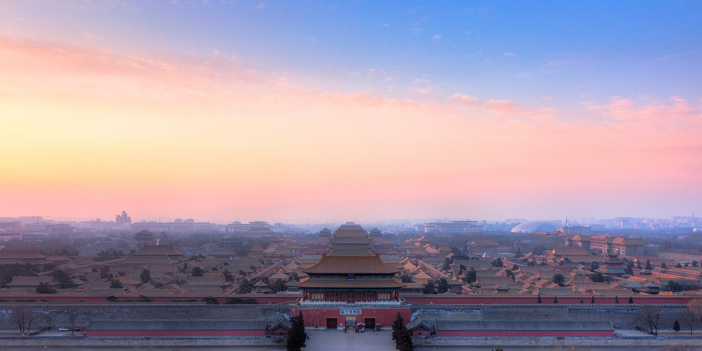

# Запретный город: 9 999 комнат императора

Вид с холма Цзиншань — классический кадр Пекина: крыши Запретного города текут золотом к горизонту, и на ноль секунд верится, что здесь жили всего один человек и его двор. 24 императора династий Мин и Цин правили Китаем из этих стен с 1420 по 1912 год, и простолюдинам вход под страхом смерти был закрыт — отсюда и «запретный». Сегодня это музей Гугун и крупнейший дворцовый комплекс мира: около 980 зданий на 72 гектарах.

Почему это влияет на цены: билеты пускают с дневным лимитом (по 80 тыс.), поэтому в высокий сезон их раскупают за дни — планируйте заранее. Осень — лучшее время: небо чистое, листья боярышника красные, толпы тоньше, чем весной на Цветочном фестивале. Вход ≈60 юаней, выставки часов и драгоценностей — по 10.

Итог: закладывайте полдня минимум, входите через южные Полуденные ворота и выходите на север — к холму Цзиншань, откуда этот вид и достают.

*Фото: Wikimedia Commons, CC BY-SA 3.0 (полные атрибуции — img/photo-credits.md)*
