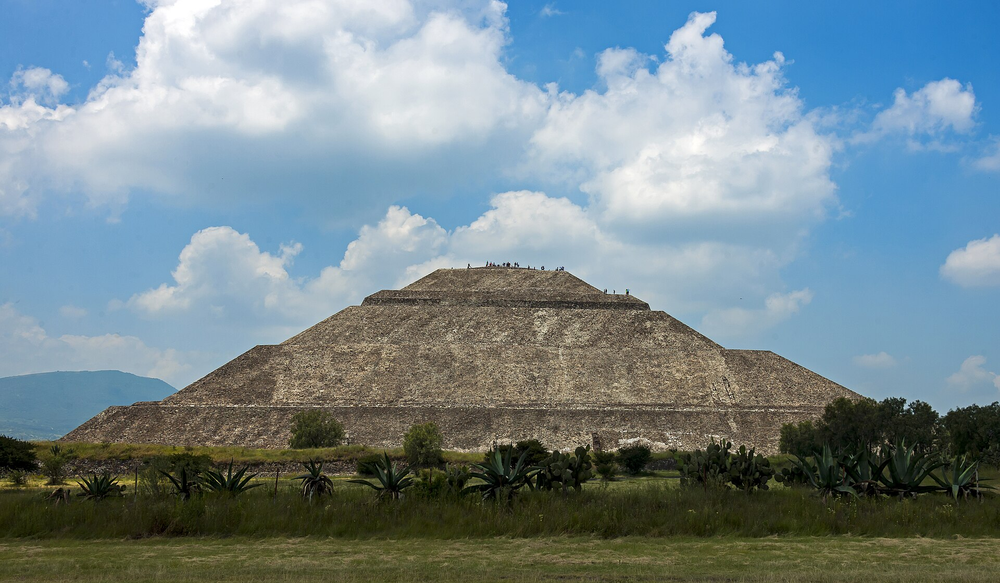

# Теотиуакан: город, который старше ацтеков

Пирамида Солнца в Теотиуакане — третья по высоте пирамида мира (63 м), и её строители нам неизвестны: город процветал в 100–600 годах н.э., к приходу ацтеков стоял полуразрушенным 500 лет, и те дали ему имя — «место, где рождаются боги». Ацтеки почитали руины как святыню, не построив тут ничего своего: настолько место говорило само за себя.

Почему это влияет на цены: до Теотиуакана 50 км от центра Мехико — всего час на автобусе с вокзала Terminal Norte за пару десятков песо, Поэтому это самая доступная «великая» достопримечательность страны: билет ≈80 песо, без обязательного гида. На пирамиды можно и нужно подниматься — со ступеней Пирамиды Луны открывается Авеню мёртвых на 4 км вперёд, вид не с открытки.

Лучшее время — ранний выезд: к полудню на Авеню мёртвых шумно и солнечно. Весеннее равноденствие сюда стягивает до миллиона человек — в эти даты цены на отели растут.

*Фото: Wikimedia Commons, CC BY-SA 3.0 (полные атрибуции — img/photo-credits.md)*
