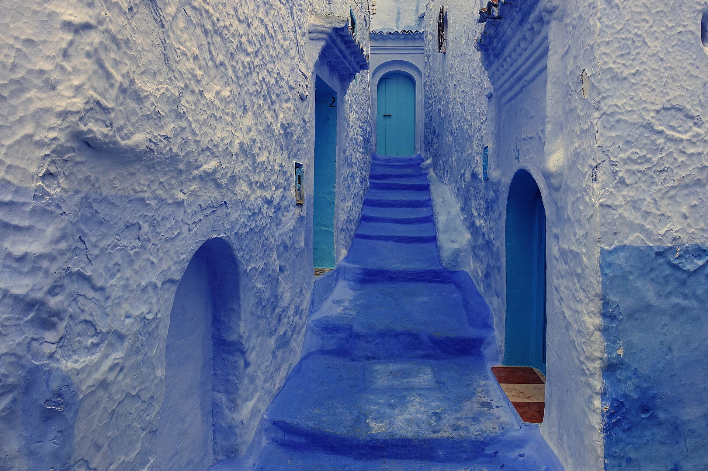

# Шефшауэн: город, покрашенный в синий

Шефшауэн — город в горах Риф, где каждая дверь, стена и ступенька выкрашены в оттенки синего: от бледного, как молоко, до ультрамарина. Пошло это, скорее всего, от еврейских беженцев 1930-х, принесших традицию красить дома как молитвенное покрывало — талит. Сегодня это самый фотографируемый город Марокко, и в высокий сезон улочки медины — сплошной поток туристов.

Почему это влияет на цены: Шефшауэн стоит в стороне от основных трасс — из Феса или Танжера 3–4 часа автобусом через серпантины, поэтому транспорт и проживание в Рифах дороже, чем «среднее» по стране. Взамен вы получаете горные походы прямо из города: к испанской мечети с видом на синюю чашу или в парк Талассемтане с водопадами.

Лучшее время — март–май и сентябрь–октябрь: свежо, синь не выцветает под +35, в медине пусто. Не берите такси до «главной площади» — центр пешеходный, и весь смысл в том, чтобы блуждать пешком.

*Фото: Wikimedia Commons, CC BY-SA 4.0 (полные атрибуции — img/photo-credits.md)*
