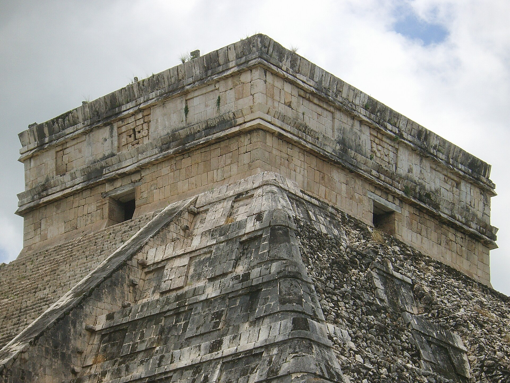

# Чичен-Ица: пирамида точной астрономии

Эль-Кастильо — пирамида Кукулькана в Чичен-Ице, и это не храм в честь бога, а календарь в камне: 365 ступеней по четырём сторонам плюс верхняя платформа дают ровно год. Самое известное шоу — весеннее и осеннее равноденствие: тень от яруса пирамиды падает на северную лестницу в виде змеи, ползущей к каменной голове Кукулькана. На это собирают тысячи людей — и гостиницы Юкатана в эти дни забиты загодя.

Почему это влияет на цены: Чичен-Ица — одно из «новых семи чудес света», поэтому билет для иностранцев ≈614 песо (≈$35), это дороже большинства достопримечательностей Мексики. Из Канкуна 2,5–3 часа, групповые туры ходят пачками; если хотите тишины — берите ранний выезд к открытию в 8 утра. Внутри пирамиды с 2006 года лазить запрещено, смотреть снаружи.

Лайфхак: берите шляпу и воду — между дворами пирамид ходить придётся в прямом солнце без тени. Объект ЮНЕСКО.

*Фото: Wikimedia Commons, CC BY-SA 4.0 (полные атрибуции — ../img/photo-credits.md)*
