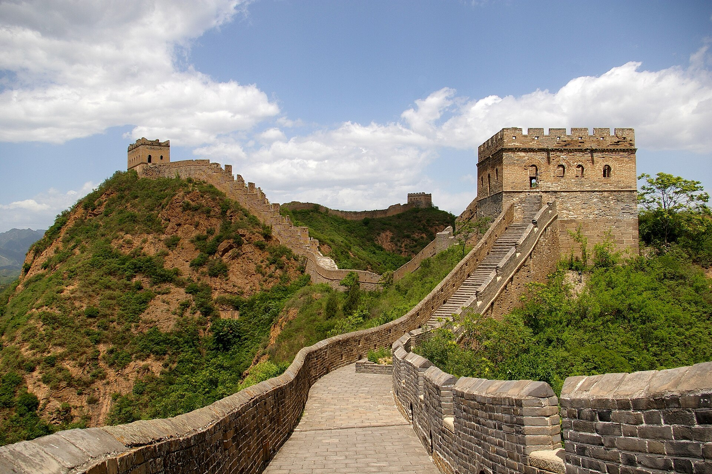

# Великая Китайская стена (Цзиньшаньлин): стены, уходящие в облака

Цзиньшаньлин — тот участок Стены, который стоит на открытке и при этом почти пустой: 10,5 км стены с 67 башнями, восстановленный, но не отглаженный под толпы, как Бадалин. Стена ведёт себя как живое существо — ныряет в ущелья, карабкается на хребты, а лестницы между башнями — под 50+ градусов. Это объект ЮНЕСКО с 1987 года, ему 400+ лет: участок строили при династиях Мин.

Почему это влияет на цены: добираться из Пекина 2–2,5 часа (120 км), поэтому групповые туры сюда дороже, чем на Бадалин, но и людей в разы меньше. Вход ≈65 юаней, канатная дорога отдельно. Лучшее время — поздняя весна и осень: весной склоны зацветают абрикосом, осенью рябина делает хребты багровыми. Летом +30 и леса в дымке, зимой красиво, но ступени леденеют.

Итог для путешественника: если в Пекине один день — Бадалин, если два — Цзиньшаньлин, ради тишины и фотографий с пустыми башнями.

*Фото: Wikimedia Commons, CC BY-SA 3.0 (полные атрибуции — ../img/photo-credits.md)*
