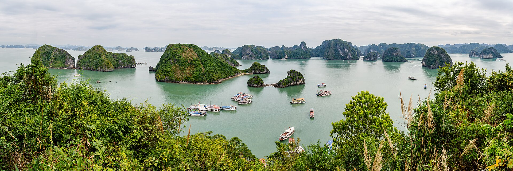

# Халонг: три тысячи островов в заливе

Бухта Халонг — это примерно 1 600 известняковых островов, разбросанных по зелёной воде до горизонта: ЮНЕСКО с 1994 года, а на местных легендах — дракон, который спустился в залив и оставил зубы-скалы. Панорама с острова Титоп — точка с лучшим обзором: остров был назван в честь космонавта Германа Титова после его визита в Северный Вьетнам в 1960-х, и на самой вершине с тех пор — смотровая площадка с тем самым видом.

Почему это влияет на цены: в Халонг ходят три уровня — однодневный круиз (от ~$50), ночная яхта (от $100–150 с человека) и люкс с палубами и коктейлями за кратно больше. Ближайшая альтернатива — Ланха-бухта и Байтулонг: тише и дешевле, природа та же, но «список зачётов» всё же у классического Халонга.

Лучшее время — октябрь–декабрь: сухо, прохладно, вода спокойная. Тайфуны летом иногда закрывают выход в залив — страховка от простоя — гибкие даты или перенос на залив Ланха.

*Фото: Wikimedia Commons, CC BY-SA 4.0 (полные атрибуции — ../img/photo-credits.md)*
