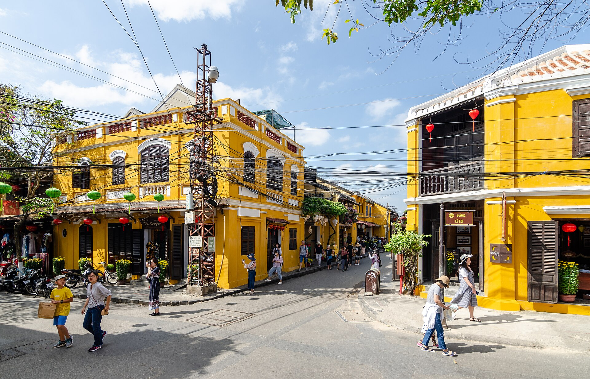

# Хойан: город фонариков у реки

Хойан — маленький портовый городок XVI–XIX веков, где за сохранившиеся 1 100 старинных зданий ЮНЕСКО дало статус, а путешественники оставили репутацию самого фотогеничного города Вьетнама. Каждый вечер по реке Тхай Бон запускают бумажные фонарики со свечами: вода превращается в дорожку огней, и вид отсюда не повторяется больше нигде в стране. А ещё Хойан — столица портных: костюм или платье по снятым меркам шьют за сутки, дешевле, чем в Ханое при том же качестве.

Почему это влияет на цены: город компактный, всё обходится пешком, но билеты на вход в старый город берут за день (≈120 000 донгов на 5 посещений достопримечательностей). Отели в самой медине дороже, чем через реку — а в 5 км лежит пляж Ан Банг, куда можно переселиться за полцены и ездить на велосипеде.

Лучшее время — февраль–апрель: сухо и тепло. Каждое 14-е число лунного месяца — «Фестиваль фонариков»:

*Фото: Wikimedia Commons, CC BY-SA 4.0 (полные атрибуции — ../img/photo-credits.md)*
