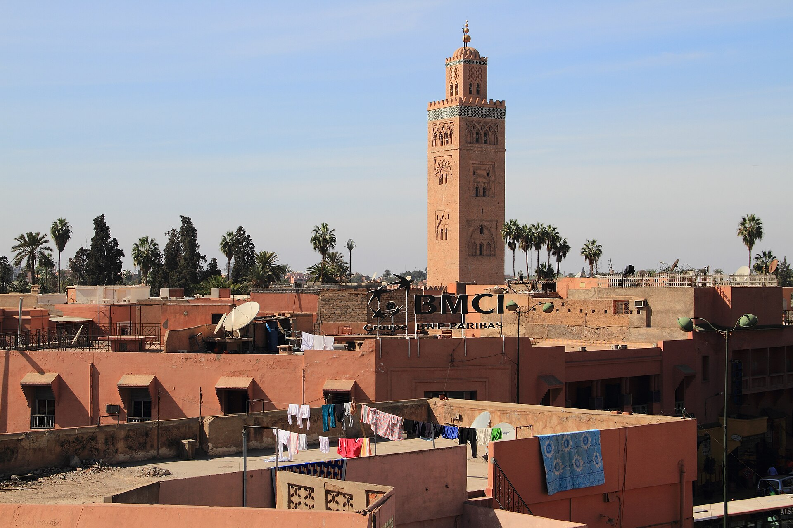

# Кутубия: минарет, по которому Марракеш виден из любого угла

77-метровый минарет Кутубии — «Эйфелева башня» Марракеша: город лежит вокруг него, как лужа, и этот силуэт видно с равнинной площади Джемаа-эль-Фна, с садов Мажорель и даже с предгорий Атласа. Построен в XII веке при Альмохадах; по легенде, на верхушке когда-то было три золотых шара — один якобы уцелел в огне и хранится как реликвия. Свечи на минарете не зажигают без приказа султана — он «спит» уже веками.

Почему это влияет на цены: сама мечеть закрыта для не-мусульман, поэтому сам осмотр бесплатен — весь маршрут проходит снаружи, вокруг парка Ла-Кутубия с оливами и фонтанами. Это делает Марракеш доступным городом: главный вид не стоит ни дирхама, а деньги расходятся на риады (от €40–60) и ужин на площади под дымом кассовых жаровен.

Лучший кадр — на закате, когда минарет розовеет на фоне Атласа. Внутрь медины заходите с утра: к полудню улицы узкие, тёплые и людные.

*Фото: Wikimedia Commons, CC BY-SA 4.0 (полные атрибуции — ../img/photo-credits.md)*
